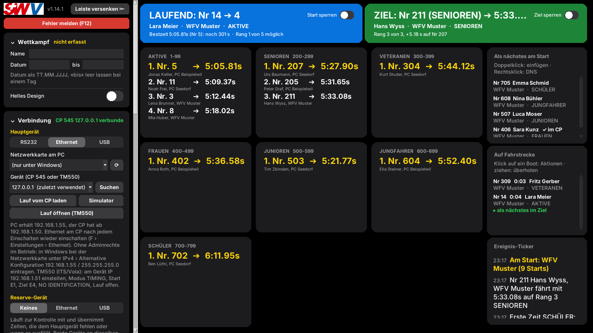
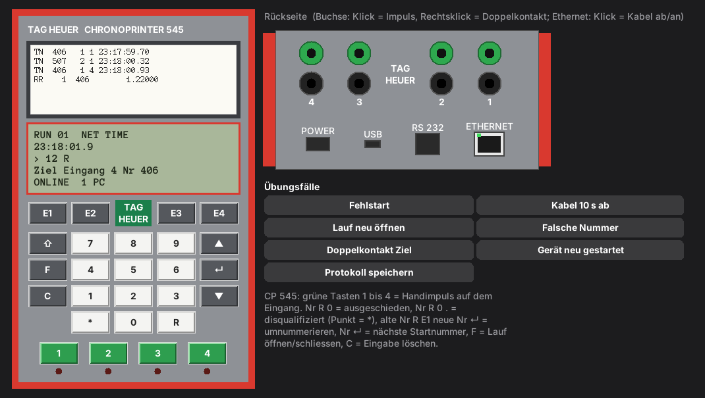
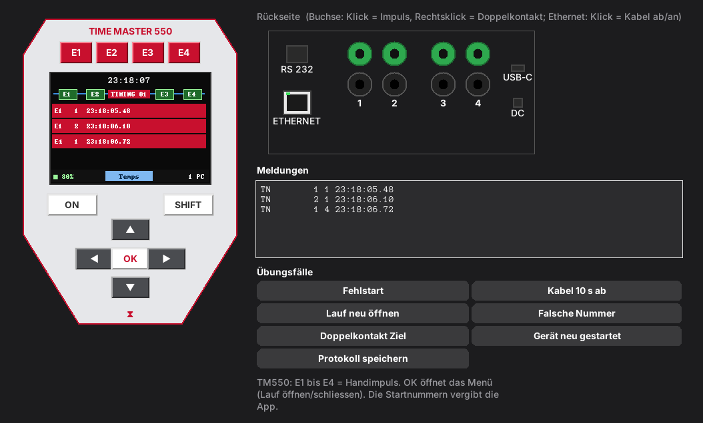

# SWV Timing Live (SWV Live-Ranking)

Speakerbildschirm für den Schweizer Wasserfahrverband (SWV). Die App liest die Zeiten des
TAG Heuer Chronoprinter CP 545 oder des ITS/Vola TM550 und zeigt Live-Zeit, Zieleinlauf, Ranglisten pro Kategorie,
nächste Starter, Ereignis-Ticker und Statistik.

## Verbindung zum Zeitmessgerät

| Art | Anschluss | Funktion |
| --- | --- | --- |
| RS232 auswerten | Anzeigetafel-Ausgang (HL970/HL980), USB-Seriell-Adapter | nur lesen |
| Ethernet steuern | Netzwerkkabel, THCOM08 auf Port 13500 | lesen und steuern |

Im Ethernet-Modus lädt die App die nächste Startnummer aus der Startliste in den CP und ordnet
die Zielimpulse selbst zu (wie SkiPro). Dazu kommen Prellzeit und Mindestfahrzeit gegen Fehlimpulse,
gesperrte Messpunkte, Nachholen fehlender Zeiten (`#RT`), Download eines Laufs (`#DL`), ein
Reserve-CP und ein eingebauter Simulator. Statt Ethernet geht auch USB: der CP hängt dann direkt am PC
(virtueller COM-Port) und wird gleich gesteuert. Jede Zeile des CP landet sofort in `rohdaten/`. Die Netzwerkkarte wird dafür auf 192.168.1.55 / 255.255.255.0 gestellt und
beim Beenden wieder auf automatische Adresse (DHCP). Der CP hat ab 192.168.1.50. Ethernet am CP ist nach jedem Einschalten wieder aus und muss neu eingeschaltet werden
(F › Einstellungen › Ethernet).

### TM550 (ITS/Vola)

USB (FTDI, 9600 Baud) oder Ethernet (Port 7000, Adresse am Gerät unter Communication). Die App erkennt
das Gerät an der Seriennummer. Einstellung am TM550: Modus TIMING, Start E1, Ziel E4, NO IDENTIFICATION,
Lauf offen, kurze Sperrzeit am Ziel. Die Startnummern vergibt die App aus der Startreihenfolge.
Verlorene Zeilen holt sie per Download des offenen Laufs; der TM550 puffert bei Unterbruch nicht. Ist kein Lauf offen,
öffnet «Lauf öffnen (TM550)» einen über die Verbindung.

### Gerätetests

`tools/geraetetest/` enthält PowerShell-Skripte, um ein Gerät ohne die App zu prüfen: `tm550_test.ps1`
(Netz, Ports, Befehle) und `fernbefehle_test.ps1` (Fernbefehle an CP 545 und TM550, jede Gruppe mit
Rückfrage, nur ausserhalb eines Rennens). Anleitung Schritt für Schritt: [docs/geraetetest.md](docs/geraetetest.md).

### Hauptgerät und Reserve-Gerät

Beide Geräte haben ihre eigene Verbindung: Hauptgerät RS232, Ethernet oder USB, Reserve-Gerät keines,
Ethernet oder USB. Möglich sind z.B. CP 545 über USB und TM550 über Ethernet, umgekehrt, oder beide über
Ethernet (zwei Adressen im Netz 192.168.1.x an derselben Netzwerkkarte). Die IP der Reserve lässt sich aus
der Suche wählen oder eintippen. Die App lernt den Uhrversatz aus gemeinsamen Impulsen, übernimmt Impulse,
die dem Hauptgerät fehlen, und fällt bei Ausfall des Hauptgeräts auf die Reserve zurück. Beide Geräte
brauchen dieselben Start- und Zielimpulse (Verteilung elektrisch mit ITS/TAG Heuer abklären).

### Üben

Unter Simulator: «Üben: CP 545 mit Tastatur» bzw. «Üben: TM550» öffnet ein nachgebautes Gerät
(Vorderseite mit Display und Tastenfeld nach Foto, Rückseite mit Bananenbuchsen und Anschlüssen) und
Übungsfälle. Die App ist damit verbunden wie mit dem echten Gerät.

## Schnittstelle für andere Programme

Die Browser-Anzeige (nur lokales Netz, mit Schlüssel) bietet zusätzlich eine API nur zum Lesen:
`/api/v1/live`, `/api/v1/results`, `/api/v1/course`, `/api/v1/startlist`, `/api/v1/events` und
den WebSocket `/ws` (`&stream=all` für alles in einer Nachricht). Übersicht unter `/api?key=…`.

Pläne für die API und die Anbindung ans Onlinetool: [docs/plaene_api_onlinetool.md](docs/plaene_api_onlinetool.md).

## Start und Build

- Python 3.9 oder neuer, `pip install pyserial`
- Start: `python swv_live_ranking.py`
- .exe bauen: `build.bat` (PyInstaller, eine Datei, ohne Konsole)
- Jeder Push auf `main` baut die .exe und den Installer auf GitHub (Actions). Ist `APP_VERSION` neu,
  entstehen automatisch Tag und Release mit `SWV_LiveRanking_Setup_x.y.z.exe` und der .exe
  (`.github/workflows/build.yml`, Installer: `installer/swv_live_ranking.iss`, Inno Setup).

## Installation und Daten

- Installer ausführen. Eine neue Version ersetzt die installierte.
- Programm: `C:\Program Files\SWV Live-Ranking`
- Daten: `Dokumente\SWV Live-Ranking` mit Einstellungen, Autosave, `logs` (Diagnose-Log),
  `rohdaten` (jede Zeile vom CP), `fehlerberichte` und `pdf`. Bleibt bei Update und Deinstallation.
- Fehler melden: Knopf oben in der Seitenleiste oder F12. Die ZIP-Datei aus `fehlerberichte` weiterleiten.

## Ablage

| Ordner | Inhalt |
| --- | --- |
| `/` | App `swv_live_ranking.py`, `build.bat` |
| `installer/` | Inno-Setup-Skript für den Installer |
| `tests/` | CP-Simulator (`cpsim.py`) und Testabläufe für Ethernet |
| `tools/` | Downloader und Rohdaten-Analyse für den CP 545 |
| `prototypen/` | erste Speaker-Board-Versionen vor dem SWV Live-Ranking |

Nicht im Repository: Startlisten, Exporte und die Dateien, die die App selbst schreibt
(Einstellungen mit dem Schlüssel der Browser-Anzeige, Kategorien, Autosave).

## Versionen

`MAJOR.MINOR.PATCH`, siehe [CHANGELOG.md](CHANGELOG.md). `main` ist immer der Stand für den
Wettkampf, grössere Umbauten laufen in eigenen Branches.

## Lizenz

MIT, siehe [LICENSE](LICENSE).
