# Benutzerhandbuch SWV Live-Ranking

Stand: App v1.23.0, CP 545 Firmware VB16, TM550 Firmware 1.48. Alle Namen in den Bildern sind erfunden.

## Inhalt

1. [Zweck und Aufbau](#1-zweck-und-aufbau)
2. [Installation, Daten, Updates](#2-installation-daten-updates)
3. [Hauptfenster](#3-hauptfenster)
4. [Vorbereitung eines Wettkampfs](#4-vorbereitung-eines-wettkampfs)
5. [Verbindung zum Gerät](#5-verbindung-zum-gerät)
6. [Zeitmessung einstellen](#6-zeitmessung-einstellen)
7. [Während des Rennens](#7-während-des-rennens)
8. [Bedienung am CP 545](#8-bedienung-am-cp-545)
9. [Bedienung am TM550](#9-bedienung-am-tm550)
10. [Hauptgerät und Reserve-Gerät](#10-hauptgerät-und-reserve-gerät)
11. [Anzeigen für Speaker und Publikum](#11-anzeigen-für-speaker-und-publikum)
12. [Onlinetool](#12-onlinetool)
13. [Resultate, Export, Druck](#13-resultate-export-druck)
14. [Störungen und Fehlerbericht](#14-störungen-und-fehlerbericht)
15. [Checkliste Wettkampftag](#15-checkliste-wettkampftag)

## 1. Zweck und Aufbau

Die App ist der Speakerbildschirm des Schweizer Wasserfahrverbands. Sie liest die Impulse des TAG Heuer
Chronoprinter CP 545 oder des ITS/Vola TM550, ordnet sie den Startnummern zu und zeigt Laufzeit, Zieleinlauf,
Ranglisten pro Kategorie, nächste Starter und Ereignisse.

Ablauf an einem Wettkampf:

1. Startliste laden.
2. Gerät verbinden (Ethernet oder USB, bei Bedarf ein Reserve-Gerät).
3. Lauf am Gerät öffnen.
4. Start- und Zielimpulse kommen von den Lichtschranken oder Handtastern, die App ordnet sie zu.
5. Korrekturen (Fehlimpuls, DNS, DNF, DSQ, Nummerntausch) in der App.
6. Resultate als CSV, PDF oder pro Verein exportieren.

Die App baut nur ausgehende Verbindungen auf. Die Browser-Anzeige ist nur lesend und nur im lokalen Netz
mit Schlüssel erreichbar.

## 2. Installation, Daten, Updates

- Installer ausführen. Eine neue Version ersetzt die installierte, Daten bleiben.
- Daten liegen in `Dokumente\SWV Live-Ranking`: Einstellungen, Autosave, `logs`, `rohdaten` (jede Zeile vom
  Gerät), `fehlerberichte`, `pdf`. «Daten › Datenordner öffnen» zeigt den Ordner.
- Die Versionsnummer oben links leuchtet:

| Farbe | Bedeutung |
| --- | --- |
| grün | aktuelle Version |
| rot | neuere Version verfügbar, Klick lädt sie |
| orange | neue Version geladen und geprüft, bereit zur Installation |

Nach dem Laden fragt die App, wann installiert wird: «Jetzt installieren» (nur ohne Verbindung und ohne
Boote auf der Strecke), «In 8 Stunden» oder «Beim Beenden der App». Die App schliesst sich nie von selbst.

## 3. Hauptfenster

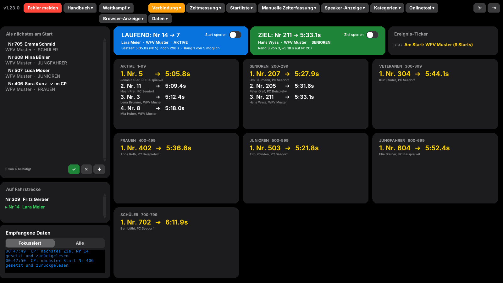

| Bereich | Inhalt |
| --- | --- |
| Menüleiste oben | Version, «Fehler melden», «Handbuch ▾» (lädt Benutzerhandbuch oder Training als PDF in der aktuellen Fassung), ein Knopf pro Bereich (klappt nach unten auf), Hell/Dunkel (☀/☾), Seitenleiste anpinnen (⇥) |
| Knopf «Verbindung» | grün: Haupt- und Reserve-Gerät verbunden, orange: eines, rot: keines |
| linke Spalte (ab der Menüleiste) | «Als nächstes am Start» (alle noch nicht gestarteten, mit Bestätigung, füllt die Höhe), «Auf Fahrstrecke» (eine Zeile pro Boot: Nr und Name, das nächste im Ziel grün mit ▸), «Empfangene Daten» |
| blaues Feld LAUFEND | Boot auf der Strecke mit laufender Zeit, Bestzeit der Kategorie, möglicher Rang, Schalter «Start sperren» |
| grünes Feld ZIEL | letzter Zieleinlauf mit Zeit und Rang, Schalter «Ziel sperren». Ist das Feld zu schmal, fällt die Kategorie in der ersten Zeile weg |
| rechts daneben | Speaker-Notiz des Boots auf der Strecke (gelb umrandet, nur wenn eine Notiz da ist) und Ereignis-Ticker |
| Karten | eine Rangliste pro Kategorie mit Nummernbereich |

Ein Klick auf einen Bereichsknopf öffnet das Ausklappfeld, ein zweiter Klick oder Wegfahren mit der Maus
schliesst es. Mit ⇥ wird die Seitenleiste dauerhaft links angezeigt:

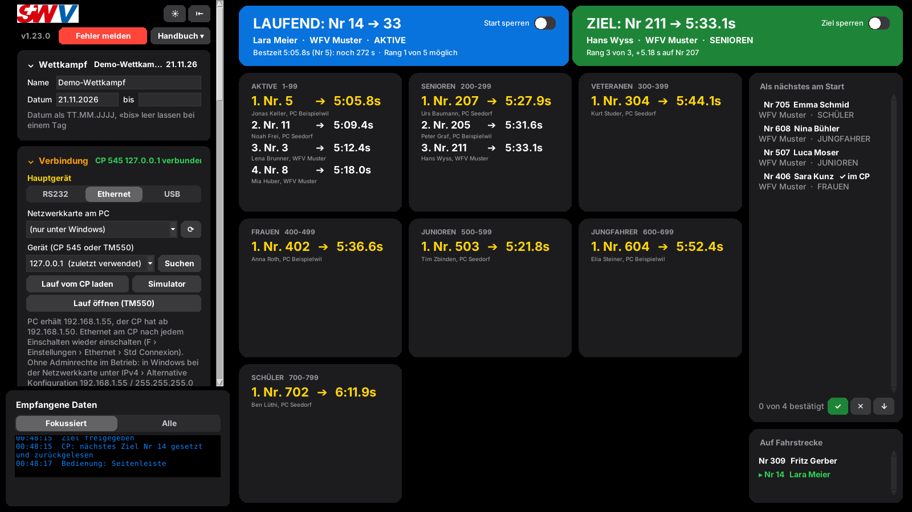

Beim ersten Start ist alles leer:

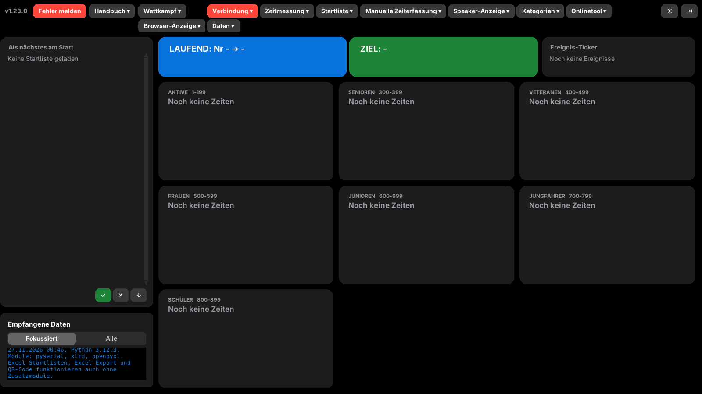

«Empfangene Daten» zeigt die Meldungen der App und die Zeilen vom Gerät. «Fokussiert» blendet Routine aus,
«Alle» zeigt jede Zeile.

Die Oberfläche passt sich an kleine Bildschirme an (13 Zoll). Feste Grösse unter «Daten › Grösse der
Oberfläche»: Auto, 90 %, 100 %, 110 %.

## 4. Vorbereitung eines Wettkampfs

### 4.1 Wettkampf

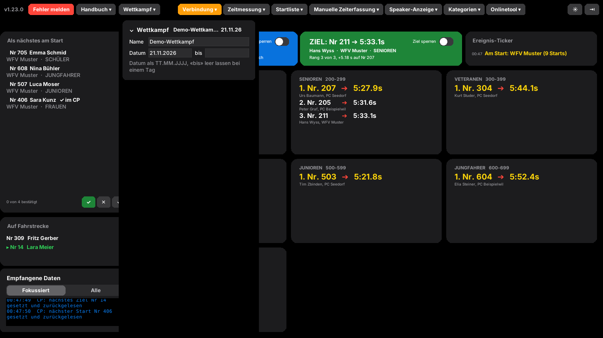

Name und Datum eintragen (TT.MM.JJJJ, «bis» leer bei einem Tag). Erscheint auf PDF und Export.

### 4.2 Startliste

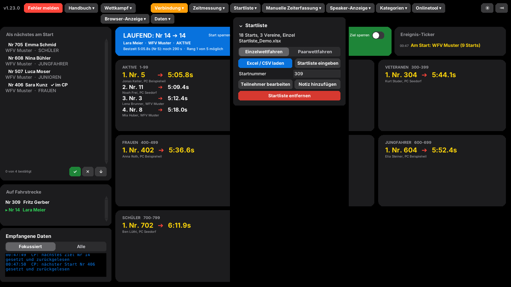

- «Einzelwettfahren» oder «Paarwettfahren» wählen.
- «Excel / CSV laden»: Datei wählen, Spalten zuordnen, «Importieren».

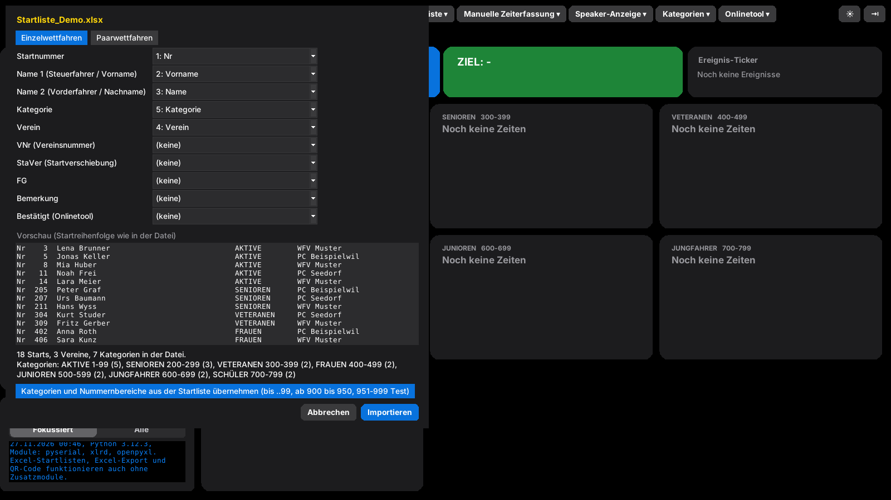

  Die App erkennt die Spalten selbst (Nr, Name, Vorname, Verein, Kategorie, VNr, StaVer, FG, Bemerkung,
  Bestätigt). Steht in «Bestätigt» x, ja oder 1, bekommt die Nummer einen blauen Haken.
  Die Vorschau zeigt die Startreihenfolge wie in der Datei. Der Schalter unten übernimmt Kategorien und
  Nummernbereiche aus der Startliste.

- «Startliste eingeben»: Nummern von Hand, z.B. `1-12, 201-215, 301`, oder eine Zeile pro Boot
  `101; Meier; Muster; WFV Muster`. Aus Excel kopierte Zeilen gehen auch. «Ersetzen» oder «Anhängen».

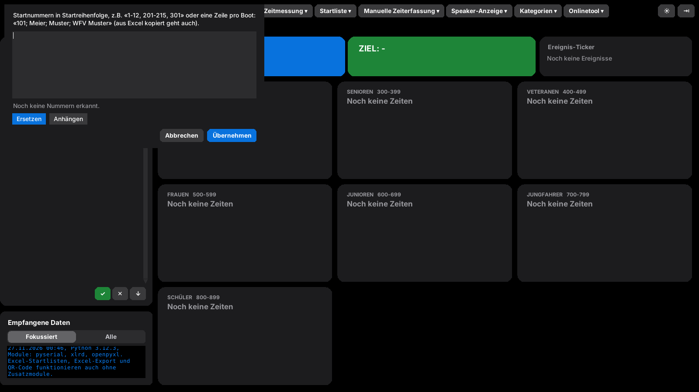

- «Startnummer»: nächste Nummer am Start setzen (z.B. nach einem Unterbruch).

### 4.2a Nummern bestätigen («Als nächstes am Start»)

Die Liste zeigt alle Nummern, die noch nicht gestartet sind, die nächste zuunterst. Sie lässt sich scrollen und
springt dabei nicht zurück. Bestätigt wird, wer am Start bereit ist:

| Bedienung | Wirkung |
| --- | --- |
| Klick auf eine Nummer | auswählen (nochmals Klick: abwählen) |
| Ctrl + Klick | weitere Nummer dazu oder weg |
| Shift + Klick | alle Nummern dazwischen |
| ✓ | gewählte Nummern bestätigen (grüner Haken) |
| ✕ | Bestätigung aufheben |
| ↓ | zur nächsten Nummer scrollen |
| Rechtsklick | bestätigen, aufheben, «Alle Bestätigungen zurücksetzen …», DNS, Nummer einfügen |

Grüne Haken (von Hand) gehen vor blauen (Onlinetool oder Spalte «Bestätigt»). Unten steht «x von y bestätigt».
Ist die nächste Nummer nicht bestätigt, steht sie orange. Bestätigungen bleiben beim neuen Import erhalten.
- «Teilnehmer bearbeiten», «Notiz hinzufügen» (Notiz erscheint beim Speaker), «Startliste entfernen».

### 4.3 Kategorien und Nummernbereiche

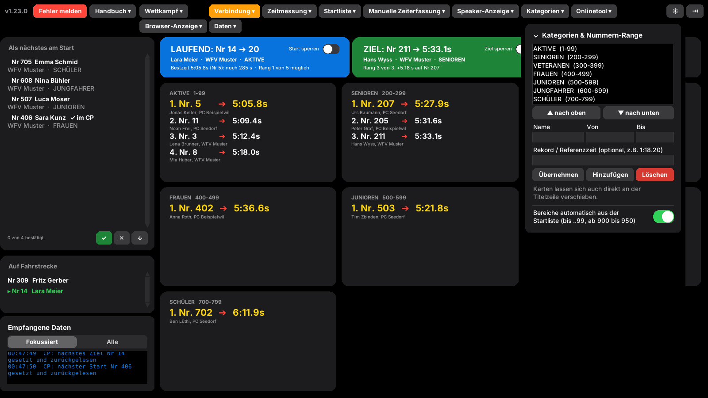

Jede Kategorie hat Name, Nummernbereich (Von, Bis) und optional einen Rekord oder eine Referenzzeit.
«Übernehmen» ändert die gewählte Kategorie, «Hinzufügen» legt eine neue an, ▲/▼ ändert die Reihenfolge der
Karten. «Bereiche automatisch aus der Startliste» bildet die Bereiche beim Import (bis ..99, ab 900 bis 950,
951 bis 999 sind Testnummern und erscheinen nicht in der Rangliste).

## 5. Verbindung zum Gerät

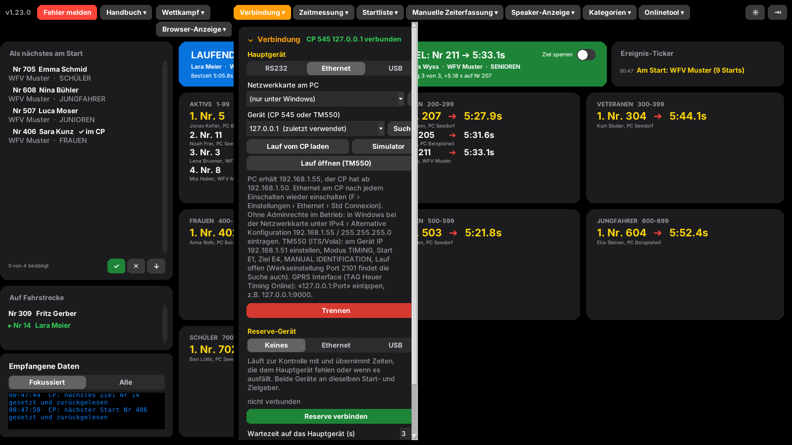

### 5.1 Hauptgerät

| Art | Wann | Funktion |
| --- | --- | --- |
| RS232 | Anzeigetafel-Ausgang des CP, USB-Seriell-Adapter | nur lesen |
| Ethernet | Netzwerkkabel PC ↔ Gerät | lesen und steuern (Startnummern laden, Lauf laden, Präzision) |
| USB | Gerät direkt am PC (virtueller COM-Port) | lesen und steuern |

Ethernet Schritt für Schritt:

1. Kabel PC ↔ CP 545 bzw. TM550 einstecken.
2. CP 545: Gerät einschalten, dann **F › Einstellungen › Ethernet** einschalten. Ethernet ist nach jedem
   Einschalten wieder aus.
3. In der App «Ethernet» wählen, «Netzwerkkarte am PC» wählen (nur Windows).
4. «Suchen» findet das Gerät, sonst Adresse eintippen. CP 545 ab 192.168.1.50, TM550 z.B. 192.168.1.51.
5. «Verbinden». Der PC bekommt 192.168.1.55 / 255.255.255.0 und beim Beenden wieder DHCP.
   Ohne Adminrechte: in Windows bei der Netzwerkkarte unter IPv4 › Alternative Konfiguration
   192.168.1.55 / 255.255.255.0 eintragen.
6. Im Kopf des Bereichs steht «CP 545 … verbunden».

Weitere Knöpfe:

- «Lauf vom CP laden»: holt alle Zeiten des offenen Laufs (nach Absturz, Neustart oder Verbindungsunterbruch).
- «Lauf öffnen (TM550)»: öffnet am TM550 einen Lauf über die Verbindung.
- «Simulator»: verbindet mit einem eingebauten Gerät zum Üben (siehe [Training](training.md)).
- TAG Heuer Timing Online (GPRS): als Adresse `127.0.0.1:Port` eintippen, z.B. `127.0.0.1:9000`.

### 5.2 Reserve-Gerät

Unter «Reserve-Gerät» Keines, Ethernet oder USB wählen und «Reserve verbinden». Details in
[Abschnitt 10](#10-hauptgerät-und-reserve-gerät).

### 5.3 Uhren prüfen und stellen

Beim ersten Verbinden von Haupt- und Reserve-Gerät prüft die App die Uhren. Im Log steht «Uhren prüfen: … einen
Zielimpuls (E4) auslösen». Ohne Boot auf der Strecke einen Impuls am Ziel auslösen, bei zwei Geräten an der
gemeinsamen Buchse. Der Impuls wird nicht gewertet.

| Ergebnis | Was die App tut |
| --- | --- |
| Gerät höchstens 1 s neben der PC-Uhr, Reserve höchstens 0,2 s neben dem Hauptgerät | Meldung «stimmen überein» |
| TM550 weicht ab | fragt «TM550 … stellen?» und stellt ihn genau zum nächsten Minutenwechsel nach der Uhr des CP 545 (bei zwei Geräten) bzw. nach der PC-Uhr. Danach nochmals einen Zielimpuls zur Kontrolle |
| CP 545 weicht ab | Anleitung: F › Synchronisation › Manuell (kein Lauf offen), Uhrzeit eingeben, Impuls auf E1. Den CP 545 kann die App nicht stellen, auch nicht über RS232 |
| zwei CP 545 weichen ab | Anleitung: an beiden dieselbe Uhrzeit eingeben und mit einem gemeinsamen Impuls auf E1 synchronisieren |

Der Knopf «Uhren prüfen» unter «Verbindung» startet die Prüfung später erneut. Sobald ein Boot auf der Strecke
ist oder Resultate da sind, ist er gesperrt: während des Wettkampfs wird keine Uhr verstellt.

Synchronisiert man am TM550 von Hand, meldet er das; die App wertet diese Zeile nicht als Start.

## 6. Zeitmessung einstellen

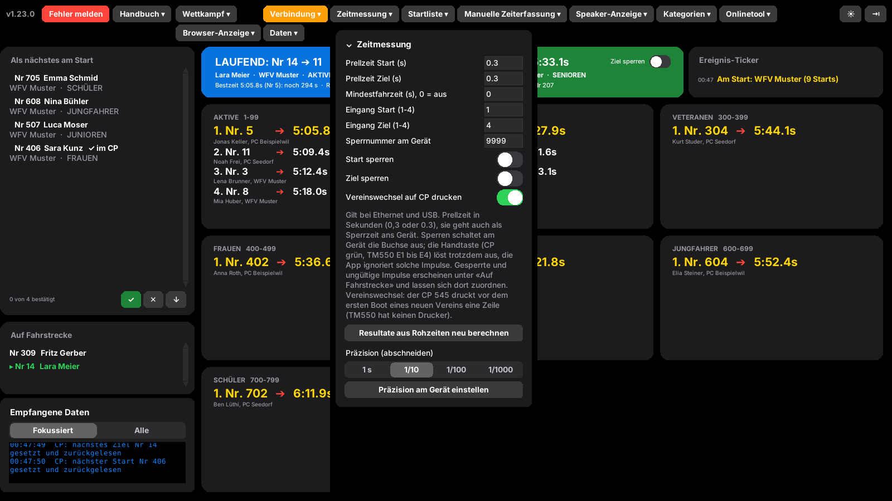

| Einstellung | Bedeutung |
| --- | --- |
| Prellzeit Start / Ziel (s) | in Sekunden, Komma oder Punkt (0,3 oder 0.3). Weitere Impulse am selben Eingang innerhalb dieser Zeit werden ignoriert (Doppelkontakt). Die App schreibt den Wert beim Verbinden und bei jeder Änderung als Sperrzeit des Eingangs ans Gerät (CP 545: Einstellungen › Sperre, TM550: Input blocking time), damit auch das Gerät den Zweitimpuls nicht dem nächsten Boot gibt |
| Mindestfahrzeit (s) | Zielimpulse vor dieser Fahrzeit gelten als Fehlimpuls, 0 = aus |
| Eingang Start / Ziel (1 bis 4) | Eingang am Gerät für Start und Ziel, Standard Start 1, Ziel 4 |
| Sperrnummer am Gerät | Nummer, die bei gesperrtem Start am Gerät vorgeladen wird, Standard 9999 |
| Start sperren / Ziel sperren | sperrt den Eingang am Gerät (CP 545 und TM550, auch Reserve); Impulse, die trotzdem kommen, werden ignoriert und unter «Auf Fahrstrecke» als gesperrt aufgeführt |
| Vereinswechsel auf CP drucken | der CP 545 druckt vor dem ersten Boot eines neuen Vereins eine Zeile |
| Resultate aus Rohzeiten neu berechnen | nach Änderung von Prellzeit, Mindestfahrzeit oder Präzision |
| Präzision (abschneiden) | 1 s, 1/10 (Standard), 1/100, 1/1000; Zeiten werden abgeschnitten, nicht gerundet |
| Präzision am Gerät einstellen | schreibt dieselbe Präzision ins Gerät, damit Papier und App übereinstimmen. Geschieht auch beim Verbinden und bei jeder Änderung der Präzision von selbst (Haupt- und Reserve-Gerät) |

Start oder Ziel sperren (z.B. Hindernis auf der Strecke, Arbeiten an der Lichtschranke):

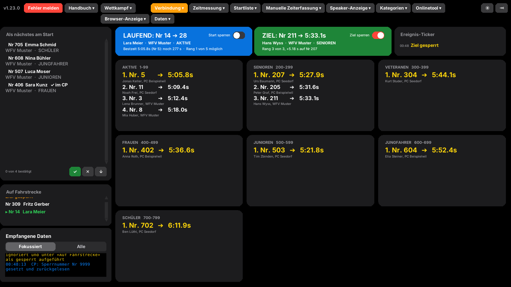

Der Schalter im Feld LAUFEND bzw. ZIEL leuchtet rot, «Auf Fahrstrecke» zeigt «Ziel gesperrt». Sind Boote
auf der Strecke, fragt die App vor dem Sperren nach.

Sperren am Gerät und in der App hängen zusammen:

| Wo gesperrt | Was passiert |
| --- | --- |
| Schalter in der App | CP 545: schwarzer Balken beim Eingang. TM550: rotes Kästchen. Die App liest den Zustand zurück |
| rote Sperrtaste am CP 545 | die App merkt es innert etwa 5 s und stellt den Schalter um (Eintrag im Ticker) |
| SHIFT + E1 bis E4 am TM550 | die App stellt den Schalter sofort um |
| beim Verbinden am Hauptgerät gesperrt | die App schaltet «Start sperren» bzw. «Ziel sperren» ein (Eintrag «beim Verbinden»). Ist in der App gesperrt, sperrt die App am Gerät. Die Reserve bekommt den Zustand der App |

Sperren schaltet am Gerät nur die Buchse aus. Die Handtaste löst auch bei gesperrtem Eingang aus: am CP 545 die
grüne Taste, am TM550 die Taste E1 bis E4 (Zustand «senden» und «gesperrt», Gerätetest 26.11.2026). Die App
ignoriert solche Impulse bei «Start sperren» bzw. «Ziel sperren». Deshalb lädt die App bei gesperrtem Start
zusätzlich die Sperrnummer 9999 vor: ein solcher Start verbraucht keine echte Startnummer. Beim Ziel gilt das
gleiche; nach «Ziel freigeben» schreibt die App die Nummer des nächsten Boots wieder an den CP.

## 7. Während des Rennens

### 7.1 Normaler Ablauf

1. Die App lädt die nächste Startnummer in das Gerät («im CP» bei der Nummer unter «Als nächstes am Start»).
2. Startimpuls: das Boot wechselt nach «Auf Fahrstrecke», das Feld LAUFEND zeigt die Zeit.
3. Zielimpuls: das Boot, das «als nächstes im Ziel» markiert ist, bekommt die Zeit und erscheint in der Rangliste.

### 7.2 Korrekturen mit der Maus

| Wo | Aktion | Menüpunkte |
| --- | --- | --- |
| «Als nächstes am Start» | Rechtsklick | «Nicht gestartet (DNS)», «Nummer darunter einfügen …», «Abwesende (DNS) darunter wieder einfügen» |
| «Als nächstes am Start» | Doppelklick | Nummer einfügen |
| «Auf Fahrstrecke» | Klick auf ein Boot | «Kommt als nächstes ins Ziel (überholt)», «Nummer ändern …», «Ausgeschieden (DNF)», «Disqualifiziert, fährt weiter ins Ziel (DSQ)», «Disqualifiziert, ist schon draussen (DSQ)», «DSQ aufheben» |
| «Auf Fahrstrecke» | Boot ziehen | Reihenfolge ändern (Überholen) |
| «Auf Fahrstrecke», Zeile gesperrter oder ungültiger Impuls | Klick | «Nr … zuordnen», «Startnummer zuordnen …», «Ungültig lassen (ausblenden)» |
| «Auf Fahrstrecke», Zeile letzter Zieleinlauf | Klick | «Zielzeit ungültig (Fehlimpuls), Boot wieder auf die Strecke» |
| «Auf Fahrstrecke», Boot direkt nach einem Zieleinlauf | Klick | «Letzte Zielzeit gehört Nr …» (statt dem Boot, das die Zeit bekam) |
| Rangliste | Rechtsklick auf eine Zeile | «Disqualifiziert (DSQ)», «Teilnehmer bearbeiten …» |

### 7.3 Manuelle Zeiterfassung

Startnummer eintragen, «Zeit manuell erfassen», dann Minuten, Sekunden und Zehntel eingeben. Für Boote ohne
gültigen Impuls (Lichtschranke ausgefallen, Handzeit).

## 8. Bedienung am CP 545

### 8.1 Vor dem Rennen

1. Gerät einschalten (Taste **ON**). Ausschalten: ON, Rückfrage «Gerät ausschalten?» mit \* (JA) bestätigen.
2. Ethernet einschalten (nur bei Ethernet, nach jedem Einschalten): **F › Einstellungen › Ethernet ›
   Std Connexion**. Die Adresse steht unter «User Connexion» (192.168.001.050).
3. Zeitmessart: **F › Zeitmessart › NET TIME**, mit ↵ wählen. Nur in NET TIME mit offenem Lauf nimmt der CP die
   Startnummern der App an. In anderen Zeitmessarten nummeriert die App selbst aus der Startreihenfolge.
4. Lauf öffnen: **F › Neuen Lauf öffnen**, Rückfrage «NEUER LAUF NR. 3 Lauf hinzufügen?» mit \* (JA)
   bestätigen. Über die Verbindung geht das nur in PTB SEQUENTIEL.
5. In der App verbinden. Die App stellt die Präzision am Gerät ein.

### 8.2 Display

| Zeile | Inhalt |
| --- | --- |
| oben | Laufnummer (z.B. 03), Balken bei gesperrten oder unbenutzten Eingängen, Uhrzeit, Zeitmessart (NT = NET TIME, PT = PTB SEQUENTIEL). Ohne Lauf vier Balken |
| zweite | links die nächste Startnummer mit ◁, rechts die nächste Zielnummer mit ▷ (leer: «____») |
| unten | Boot auf der Strecke mit laufender Zeit (z.B. «1▷ 5.8»), nach dem Ziel Nr und Laufzeit |

### 8.3 Tasten

| Tasten | Wirkung | Zeile an die App |
| --- | --- | --- |
| grüne Tasten 1 bis 4 | Handimpuls auf Eingang 1 bis 4, auch bei gesperrtem Eingang | `TN … M1` |
| rote Tasten unter den grünen | Eingang sperren (Balken) bzw. öffnen | |
| Nr E1 | nächste Startnummer eingeben | |
| E1 allein | Fehlstart: Nummer von der letzten Startzeit entfernen | `TC` |
| \* E1 | Eingabe löschen, rückgängig | |
| alte Nr R E1 neue Nr ↵ | Nummer umnummerieren | `T-` alte, `T*` neue |
| Nr R 0 | ausgeschieden (DNF) | |
| Nr R 0 \* | disqualifiziert (DSQ) | |
| F | Menü öffnen bzw. zurück | |
| ▲ ▼, ↵ | im Menü wählen; in Rückfragen \* = JA, ↵ = NEIN | |
| ON | Ausschalten | |

Ein Impuls von der Buchse kommt als `TN … 1` (ohne M), von der grünen Taste als `TN … M1`.

### 8.4 Menü F

| Ohne offenen Lauf | Mit offenem Lauf |
| --- | --- |
| CP545 Ausschalten | Lauf schliessen |
| Neuen Lauf öffnen | Rangliste |
| Synchronisation (Manuell oder extern, Master/Slave RS232) | Rangliste Lauf |
| Speicher löschen | Noch im Rennen |
| Rangliste Lauf | Kopieren |
| Rally Einstellungen | Zeit einfügen |
| Zeitmessart (15 Arten) | Geschwindigkeit |
| Einstellungen | Einstellungen |
| Geschwindigkeit | Drucker |
| Drucker | Lauf einfügen |
| Herunterladen | |

Unter **Einstellungen**: Präzision, Sperre (Sperrzeit pro Eingang), Numerierung, Status Eingänge, RFID Auto Inkrem.,
LCD Kontrast, Hintergrundlicht, HG-Beleuchtung, LCD Dauer, Piep, RS232 (Zum PC, HL960/HL990, HL970/HL980, ALGE
Display, Ext. Drucker), Ethernet, Sprache, Battery Type, Error Messages, Parameter drucken.

### 8.5 Papier

Der CP druckt jede Zeit, das Resultat als «R <Rang> Laufzeit». Mit «Vereinswechsel auf CP drucken» kommt vor dem
ersten Boot eines neuen Vereins eine Zeile mit dem Vereinsnamen. «Sock error RST 0» und «TCP Schliessen socket 0»
druckt der CP, wenn die Verbindung zum PC getrennt wird (abschalten unter Einstellungen › Error Messages).

## 9. Bedienung am TM550

1. Gerät einschalten (**ON** 5 s halten).
2. Ethernet: Menü › Communication › Ethernet, z.B. 192.168.1.51, Port 7000. Werkseinstellung Port 2101 findet die
   Suche auch. USB: Communication › USB › **9600 Bds** (nicht «9600 Bds Flow control»), in der App 9600 Baud.
3. Timing modes › Timing › Activate On, Timing 1 mit Start E1 und Ziel E4. Identification mode: Manual
   identification.
4. Uhr: Synchronisation › Manual oder GPS, vor dem Öffnen des Laufs. Steht oben «WAIT GPS», ist die Uhr nicht
   gestellt (die App meldet Datum und Uhrzeit des Geräts).
5. Lauf öffnen am Gerät (Menü Run) oder in der App «Lauf öffnen (TM550)».

### 9.1 Display

| Bereich | Bedeutung |
| --- | --- |
| Kästchen über E1 bis E4 | grün mit Pfeil nach oben: offen; rot mit Pfeil nach unten: senden; rot: gesperrt |
| Eingangsnamen | grün: in der Zeitmessart benutzt, blau: nicht benutzt |
| Mitte | WAIT GPS (Uhr nicht gestellt) bzw. SYNC GPS |
| rote Zeilen | pro Boot: Messung T1, Nr, Startzeit, Zielzeit (gelb), Laufzeit |
| Statusleiste | Akku, Standort, Ton, Ethernet (durchgestrichen = nicht verbunden), Bluetooth, Drucker, Zeitmessart |

### 9.2 Tasten und Menü

| Tasten | Wirkung |
| --- | --- |
| E1 bis E4 | Handimpuls; bei gesperrtem Eingang kein Impuls |
| SHIFT, dann E1 bis E4 | Eingang weiterschalten: offen → senden → gesperrt → offen |
| ◀ | Menü Run (Current run, Close a run, Download run, Erase all runs), nochmals ◀: Hauptmenü |
| ▲ ▼, OK oder ▶ | wählen; ◀ zurück |

Hauptmenü: Status, Synchronisation, Run, Timing modes, Precision, Input blocking time, Options, Communication,
Scoreboard, Update, Turn off.

In TIMING lädt die App die nächste Startnummer vor, sonst vergibt sie die Nummern selbst. Der TM550 puffert bei
einem Unterbruch nicht: fehlende Zeilen holt die App per Download des offenen Laufs. Ein Drucker geht nur über die
Smartphone-App (Printer BLE), nicht über die App am PC.

Hinweis: Bananenstecker an E4 können prellen (Doppelkontakt, im Test 0,1 s). Die Prellzeit Ziel fängt das ab;
die App schreibt sie auch als Sperrzeit ans Gerät. Ab Werk steht der TM550 auf 0,1 s, das ist zu kurz. Am TM550
wirkt die Sperrzeit auf Buchse und Taste, am CP 545 nur auf die Buchse: eine doppelt gedrückte grüne Taste fängt
nur die Prellzeit der App ab.

## 10. Hauptgerät und Reserve-Gerät

Beide Geräte hängen an denselben Start- und Zielimpulsen. Mögliche Kombinationen: CP 545 über USB und TM550
über Ethernet, umgekehrt, oder beide über Ethernet (zwei Adressen 192.168.1.x an derselben Netzwerkkarte).

- Die App lernt den Uhrversatz der Reserve aus gemeinsamen Impulsen. Vor dem ersten gemeinsamen Impuls
  schätzt sie ihn aus der Empfangszeit (±0,3 s).
- Impulse, die dem Hauptgerät fehlen, übernimmt sie von der Reserve. Fällt das Hauptgerät aus, liefert die
  Reserve alle Zeiten.
- «Wartezeit auf das Hauptgerät (s)»: so lange wartet die App auf den Impuls des Hauptgeräts, bevor sie den
  Impuls der Reserve verwendet.
- Zwei Impulse gelten als derselbe, wenn sie nach Umrechnung der Uhr höchstens 0,05 s plus die Auflösung des
  gröberen Geräts auseinanderliegen (CP 545 bei 1/10: Zeitzeilen 1/100; TM550 bei 1/10: Zeitzeilen 1/10, also
  0,15 s). Bei mehreren passt der nächstgelegene.
- Ein Zweitimpuls innerhalb der Prellzeit, der nur an einem Gerät ankommt (Doppelkontakt), wird ohne Rückfrage
  verworfen.
- Handimpuls am Hauptgerät (grüne Taste am CP, Taste am TM550): die Reserve hat ihn nicht. Die App überträgt ihn:
  an einen TM550 als Zeit (`#WC 014`, auf seine Uhr umgerechnet), an einen CP 545 als Handimpuls (`#WC 008`,
  Zeit = Empfang, etwas später). So läuft das Boot an der Reserve nicht weiter.

Hat nur die Reserve einen Impuls, fragt die App:

| Knopf | Wirkung |
| --- | --- |
| «Reserve übernehmen» | Impuls der Reserve gilt |
| «Hauptgerät gilt (Impuls verwerfen)» | Impuls wird verworfen |
| «Für diese Sitzung immer so» | gleiche Antwort für alle weiteren Fälle bis zum Neustart |

Bis zur Antwort gilt die Zeit der Reserve vorläufig. Das Fenster schliessen heisst: Reserve bleibt.

## 11. Anzeigen für Speaker und Publikum

### 11.1 Speaker-Anzeige

Schalter für Bestzeit-Vergleich, Rangprognose, Einordnung Ziel, Ereignis-Ticker, Als nächstes, Statistik,
Namen in Rangliste, Notizen.

### 11.2 Browser-Anzeige im lokalen Netz

1. Netzwerkadresse dieses PCs wählen, Port (Standard 8080).
2. «Browser-Anzeige starten».
3. «Link kopieren» oder «QR-Code» an Tablets, Handys oder einen zweiten Bildschirm geben.
4. «Neuer Schlüssel» macht alte Links ungültig.

Die Browser-Anzeige zeigt Laufend, Ziel, Ranglisten, «Als nächstes am Start», den Ereignis-Ticker (letzte 15) und
die Speaker-Notiz des Boots auf der Strecke (nur mit Schalter «Notizen» unter Speaker-Anzeige).

Nur lesend, nur private Netzwerke, Zugriff nur mit Schlüssel im Link.

## 12. Onlinetool

- «Einstellungen Onlinetool»: Modus und Zugang.
- «Upload-Warteschlange»: Resultate, die noch hochgeladen werden («Upload: 12 offen»).
- «Startliste vom Onlinetool laden».

## 13. Resultate, Export, Druck

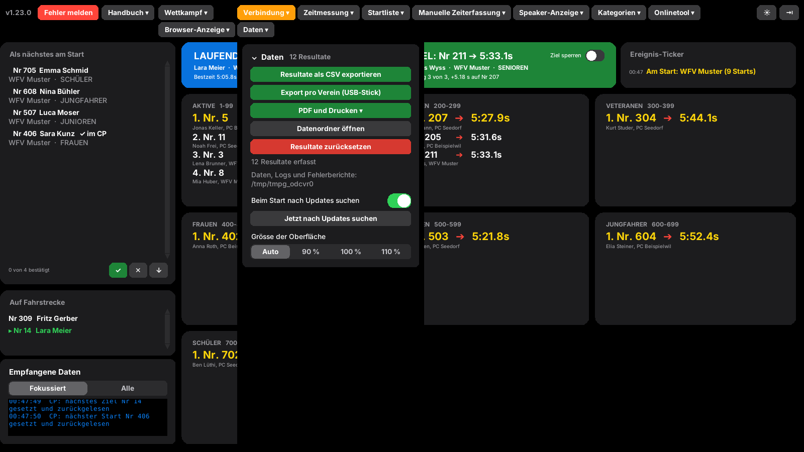

| Knopf | Ergebnis |
| --- | --- |
| Resultate als CSV exportieren | eine Datei mit allen Resultaten |
| Export pro Verein (USB-Stick) | eine Datei pro Verein |
| PDF und Drucken ▾ | Rangliste, Startliste, Zeitprotokoll als PDF; Rangliste und Startliste drucken (öffnet PDF, Ctrl+P) |
| Datenordner öffnen | Ordner mit Autosave, Rohdaten, Logs, PDF |
| Resultate zurücksetzen | löscht alle Resultate (Rückfrage) |
| Beim Start nach Updates suchen, Jetzt nach Updates suchen | Updates |

Die App speichert laufend (Autosave). Nach einem Absturz oder Neustart sind die Resultate wieder da;
fehlende Zeiten holt «Lauf vom CP laden».

## 14. Störungen und Fehlerbericht

| Anzeichen | Ursache | Abhilfe |
| --- | --- | --- |
| «Verbindung» rot, CP nicht gefunden | Ethernet am CP aus oder andere Adresse | F › Einstellungen › Ethernet › Std Connexion, Adresse unter «User Connexion» mit dem Suchbereich in der Meldung vergleichen |
| Meldung «nur beim Reserve-Gerät» bei jedem Impuls | Uhr der Reserve springt oder Präzision verschieden | Präzision am Gerät einstellen, Uhr der Reserve stellen |
| USB am TM550 stumm | Baudrate oder Flow control | Communication › USB › 9600 Bds |
| Meldung «Uhr … geht … vor/nach» | Uhr am Gerät falsch | «Uhren prüfen» (TM550 stellt die App), CP 545: F › Synchronisation |
| Verbindung da, aber keine Startnummern im CP | keine NET TIME oder kein Lauf offen | NET TIME wählen, Lauf öffnen |
| Ziel doppelt | Doppelkontakt, Bananenstecker | Prellzeit Ziel erhöhen, Zeitzeile unter «Auf Fahrstrecke» ungültig lassen |
| Zielzeit beim falschen Boot | Überholen | Boot ziehen oder «Kommt als nächstes ins Ziel (überholt)», bei schon vergebener Zeit «Letzte Zielzeit gehört Nr …» |
| Fehlimpuls am Ziel | Ast, Welle, Person in der Lichtschranke | «Zielzeit ungültig (Fehlimpuls), Boot wieder auf die Strecke» |
| Kabel kurz ab | Unterbruch | App holt fehlende Zeiten selbst (`#RT`), sonst «Lauf vom CP laden» |
| Gerät neu gestartet | Stromunterbruch | Ethernet einschalten (F › Einstellungen › Ethernet › Std Connexion), gleichen Lauf öffnen, «Lauf vom CP laden» |
| Papier zeigt andere Stellen als die App | Präzision am CP anders | «Präzision am Gerät einstellen» |

Fehler melden: Knopf «Fehler melden» neben der Version oder **F12**. Der Zeitpunkt wird markiert. Kurz
beschreiben, was passiert ist und was erwartet war, «Bericht speichern». Die ZIP-Datei aus
`Dokumente\SWV Live-Ranking\fehlerberichte` weiterleiten. Die App sendet nichts von selbst.

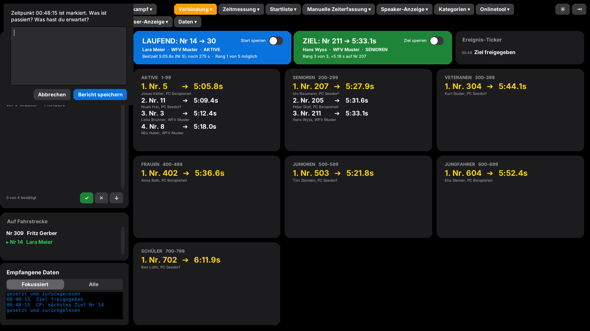

## 15. Checkliste Wettkampftag

| Wann | Schritt |
| --- | --- |
| Vortag | Startliste laden, Kategorien prüfen, Wettkampf eintragen, Update installieren |
| Aufbau | Lichtschranken an Eingang 1 (Start) und 4 (Ziel), Kabel zum PC, Reserve-Gerät parallel |
| Gerät | ON, Ethernet einschalten, NET TIME (CP) bzw. TIMING (TM550), Lauf öffnen, alle Eingänge offen |
| Uhren | nach dem Verbinden Testimpuls am Ziel, Meldung «stimmen überein» abwarten |
| App | verbinden, «Verbindung» grün, Präzision am Gerät einstellen, Testimpuls mit Testnummer 951 bis 999 |
| Rennen | Startnummern im Blick («im CP»), Boote am Start bestätigen, Korrekturen sofort |
| Ende | PDF Rangliste, Export pro Verein, Daten sichern, dann trennen |
