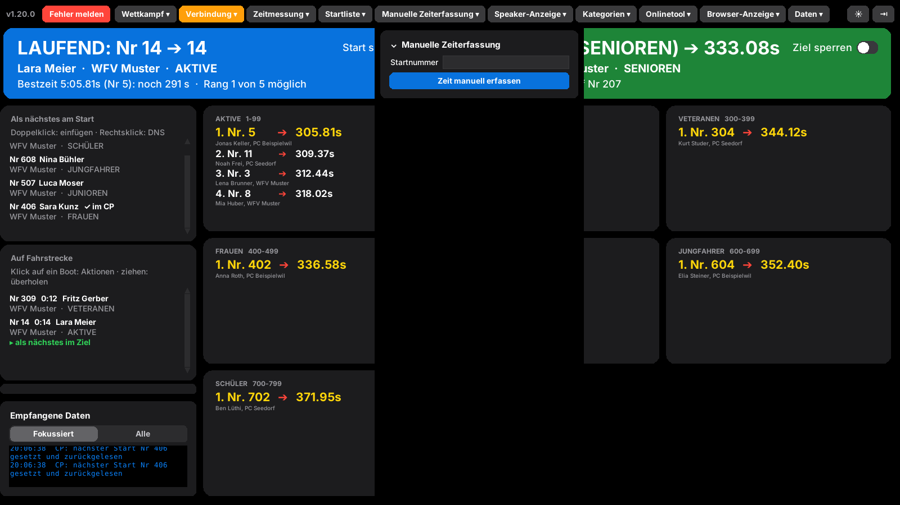
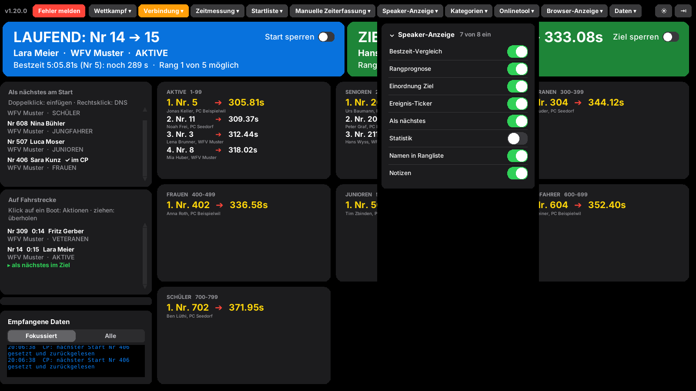
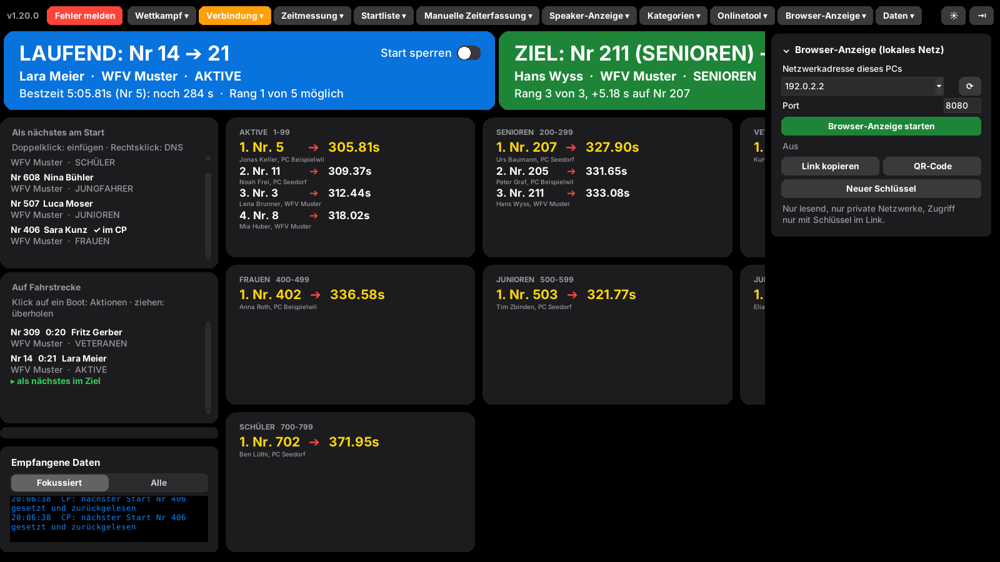
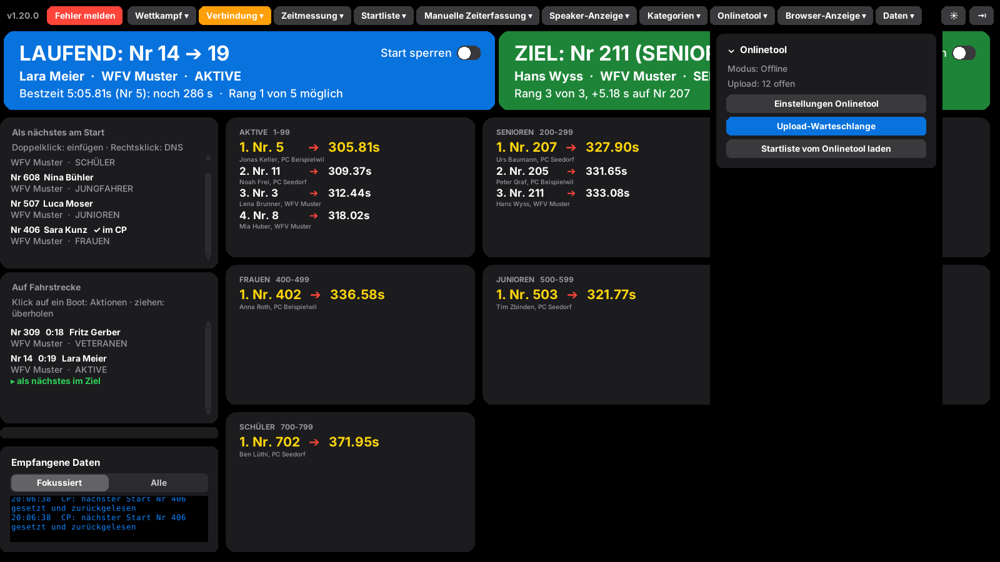

# Benutzerhandbuch SWV Live-Ranking

Stand: App v1.20.0, CP 545 Firmware VB16, TM550 Firmware 1.48. Alle Namen in den Bildern sind erfunden.

## Inhalt

1. [Zweck und Aufbau](#1-zweck-und-aufbau)
2. [Installation, Daten, Updates](#2-installation-daten-updates)
3. [Hauptfenster](#3-hauptfenster)
4. [Vorbereitung eines Wettkampfs](#4-vorbereitung-eines-wettkampfs)
5. [Verbindung zum Gerät](#5-verbindung-zum-gerät)
6. [Zeitmessung einstellen](#6-zeitmessung-einstellen)
7. [Während des Rennens](#7-während-des-rennens)
8. [Bedienung am CP 545](#8-bedienung-am-cp-545)
9. [Bedienung am TM550](#9-bedienung-am-tm550)
10. [Hauptgerät und Reserve-Gerät](#10-hauptgerät-und-reserve-gerät)
11. [Anzeigen für Speaker und Publikum](#11-anzeigen-für-speaker-und-publikum)
12. [Onlinetool](#12-onlinetool)
13. [Resultate, Export, Druck](#13-resultate-export-druck)
14. [Störungen und Fehlerbericht](#14-störungen-und-fehlerbericht)
15. [Checkliste Wettkampftag](#15-checkliste-wettkampftag)

## 1. Zweck und Aufbau

Die App ist der Speakerbildschirm des Schweizer Wasserfahrverbands. Sie liest die Impulse des TAG Heuer
Chronoprinter CP 545 oder des ITS/Vola TM550, ordnet sie den Startnummern zu und zeigt Laufzeit, Zieleinlauf,
Ranglisten pro Kategorie, nächste Starter und Ereignisse.

Ablauf an einem Wettkampf:

1. Startliste laden.
2. Gerät verbinden (Ethernet oder USB, bei Bedarf ein Reserve-Gerät).
3. Lauf am Gerät öffnen.
4. Start- und Zielimpulse kommen von den Lichtschranken oder Handtastern, die App ordnet sie zu.
5. Korrekturen (Fehlimpuls, DNS, DNF, DSQ, Nummerntausch) in der App.
6. Resultate als CSV, PDF oder pro Verein exportieren.

Die App baut nur ausgehende Verbindungen auf. Die Browser-Anzeige ist nur lesend und nur im lokalen Netz
mit Schlüssel erreichbar.

## 2. Installation, Daten, Updates

- Installer ausführen. Eine neue Version ersetzt die installierte, Daten bleiben.
- Daten liegen in `Dokumente\SWV Live-Ranking`: Einstellungen, Autosave, `logs`, `rohdaten` (jede Zeile vom
  Gerät), `fehlerberichte`, `pdf`. «Daten › Datenordner öffnen» zeigt den Ordner.
- Die Versionsnummer oben links leuchtet:

| Farbe | Bedeutung |
| --- | --- |
| grün | aktuelle Version |
| rot | neuere Version verfügbar, Klick lädt sie |
| orange | neue Version geladen und geprüft, bereit zur Installation |

Nach dem Laden fragt die App, wann installiert wird: «Jetzt installieren» (nur ohne Verbindung und ohne
Boote auf der Strecke), «In 8 Stunden» oder «Beim Beenden der App». Die App schliesst sich nie von selbst.

## 3. Hauptfenster

| Bereich | Inhalt |
| --- | --- |
| Menüleiste oben | Version, «Fehler melden», ein Knopf pro Bereich (klappt nach unten auf), Hell/Dunkel (☀/☾), Seitenleiste anpinnen (⇥) |
| Knopf «Verbindung» | grün: Haupt- und Reserve-Gerät verbunden, orange: eines, rot: keines |
| blaues Feld LAUFEND | Boot auf der Strecke mit laufender Zeit, Bestzeit der Kategorie, möglicher Rang, Schalter «Start sperren» |
| grünes Feld ZIEL | letzter Zieleinlauf mit Zeit und Rang, Schalter «Ziel sperren» |
| linke Spalte | «Als nächstes am Start», «Auf Fahrstrecke», Ereignis-Ticker, «Empfangene Daten» |
| Karten | eine Rangliste pro Kategorie mit Nummernbereich |

Ein Klick auf einen Bereichsknopf öffnet das Ausklappfeld, ein zweiter Klick oder Wegfahren mit der Maus
schliesst es. Mit ⇥ wird die Seitenleiste dauerhaft links angezeigt:

Beim ersten Start ist alles leer:

«Empfangene Daten» zeigt die Meldungen der App und die Zeilen vom Gerät. «Fokussiert» blendet Routine aus,
«Alle» zeigt jede Zeile.

Die Oberfläche passt sich an kleine Bildschirme an (13 Zoll). Feste Grösse unter «Daten › Grösse der
Oberfläche»: Auto, 90 %, 100 %, 110 %.

## 4. Vorbereitung eines Wettkampfs

### 4.1 Wettkampf

Name und Datum eintragen (TT.MM.JJJJ, «bis» leer bei einem Tag). Erscheint auf PDF und Export.

### 4.2 Startliste

- «Einzelwettfahren» oder «Paarwettfahren» wählen.
- «Excel / CSV laden»: Datei wählen, Spalten zuordnen, «Importieren».

  Die App erkennt die Spalten selbst (Nr, Name, Vorname, Verein, Kategorie, VNr, StaVer, FG, Bemerkung).
  Die Vorschau zeigt die Startreihenfolge wie in der Datei. Der Schalter unten übernimmt Kategorien und
  Nummernbereiche aus der Startliste.

- «Startliste eingeben»: Nummern von Hand, z.B. `1-12, 201-215, 301`, oder eine Zeile pro Boot
  `101; Meier; Muster; WFV Muster`. Aus Excel kopierte Zeilen gehen auch. «Ersetzen» oder «Anhängen».

- «Startnummer»: nächste Nummer am Start setzen (z.B. nach einem Unterbruch).
- «Teilnehmer bearbeiten», «Notiz hinzufügen» (Notiz erscheint beim Speaker), «Startliste entfernen».

### 4.3 Kategorien und Nummernbereiche

Jede Kategorie hat Name, Nummernbereich (Von, Bis) und optional einen Rekord oder eine Referenzzeit.
«Übernehmen» ändert die gewählte Kategorie, «Hinzufügen» legt eine neue an, ▲/▼ ändert die Reihenfolge der
Karten. «Bereiche automatisch aus der Startliste» bildet die Bereiche beim Import (bis ..99, ab 900 bis 950,
951 bis 999 sind Testnummern und erscheinen nicht in der Rangliste).

## 5. Verbindung zum Gerät

### 5.1 Hauptgerät

| Art | Wann | Funktion |
| --- | --- | --- |
| RS232 | Anzeigetafel-Ausgang des CP, USB-Seriell-Adapter | nur lesen |
| Ethernet | Netzwerkkabel PC ↔ Gerät | lesen und steuern (Startnummern laden, Lauf laden, Präzision) |
| USB | Gerät direkt am PC (virtueller COM-Port) | lesen und steuern |

Ethernet Schritt für Schritt:

1. Kabel PC ↔ CP 545 bzw. TM550 einstecken.
2. CP 545: Gerät einschalten, dann **F › Einstellungen › Ethernet** einschalten. Ethernet ist nach jedem
   Einschalten wieder aus.
3. In der App «Ethernet» wählen, «Netzwerkkarte am PC» wählen (nur Windows).
4. «Suchen» findet das Gerät, sonst Adresse eintippen. CP 545 ab 192.168.1.50, TM550 z.B. 192.168.1.51.
5. «Verbinden». Der PC bekommt 192.168.1.55 / 255.255.255.0 und beim Beenden wieder DHCP.
   Ohne Adminrechte: in Windows bei der Netzwerkkarte unter IPv4 › Alternative Konfiguration
   192.168.1.55 / 255.255.255.0 eintragen.
6. Im Kopf des Bereichs steht «CP 545 … verbunden».

Weitere Knöpfe:

- «Lauf vom CP laden»: holt alle Zeiten des offenen Laufs (nach Absturz, Neustart oder Verbindungsunterbruch).
- «Lauf öffnen (TM550)»: öffnet am TM550 einen Lauf über die Verbindung.
- «Simulator»: verbindet mit einem eingebauten Gerät zum Üben (siehe [Training](training.md)).
- TAG Heuer Timing Online (GPRS): als Adresse `127.0.0.1:Port` eintippen, z.B. `127.0.0.1:9000`.

### 5.2 Reserve-Gerät

Unter «Reserve-Gerät» Keines, Ethernet oder USB wählen und «Reserve verbinden». Details in
[Abschnitt 10](#10-hauptgerät-und-reserve-gerät).

## 6. Zeitmessung einstellen

| Einstellung | Bedeutung |
| --- | --- |
| Prellzeit Start / Ziel (ms) | weitere Impulse am selben Eingang innerhalb dieser Zeit werden ignoriert (Doppelkontakt) |
| Mindestfahrzeit (s) | Zielimpulse vor dieser Fahrzeit gelten als Fehlimpuls, 0 = aus |
| Eingang Start / Ziel (1 bis 4) | Eingang am Gerät für Start und Ziel, Standard Start 1, Ziel 4 |
| Sperrnummer am Gerät | Nummer, die bei gesperrtem Start am Gerät vorgeladen wird, Standard 999 |
| Start sperren / Ziel sperren | Impulse werden ignoriert und unter «Auf Fahrstrecke» als gesperrt aufgeführt |
| Vereinswechsel auf CP drucken | der CP 545 druckt vor dem ersten Boot eines neuen Vereins eine Zeile |
| Resultate aus Rohzeiten neu berechnen | nach Änderung von Prellzeit, Mindestfahrzeit oder Präzision |
| Präzision (abschneiden) | 1 s, 1/10, 1/100, 1/1000; Zeiten werden abgeschnitten, nicht gerundet |
| Präzision am Gerät einstellen | schreibt dieselbe Präzision in den CP 545, damit Papier und App übereinstimmen |

Start oder Ziel sperren (z.B. Hindernis auf der Strecke, Arbeiten an der Lichtschranke):

Der Schalter im Feld LAUFEND bzw. ZIEL leuchtet rot, «Auf Fahrstrecke» zeigt «Ziel gesperrt». Sind Boote
auf der Strecke, fragt die App vor dem Sperren nach.

## 7. Während des Rennens

### 7.1 Normaler Ablauf

1. Die App lädt die nächste Startnummer in das Gerät («im CP» bei der Nummer unter «Als nächstes am Start»).
2. Startimpuls: das Boot wechselt nach «Auf Fahrstrecke», das Feld LAUFEND zeigt die Zeit.
3. Zielimpuls: das Boot, das «als nächstes im Ziel» markiert ist, bekommt die Zeit und erscheint in der Rangliste.

### 7.2 Korrekturen mit der Maus

| Wo | Aktion | Menüpunkte |
| --- | --- | --- |
| «Als nächstes am Start» | Rechtsklick | «Nicht gestartet (DNS)», «Nummer darunter einfügen …», «Abwesende (DNS) darunter wieder einfügen» |
| «Als nächstes am Start» | Doppelklick | Nummer einfügen |
| «Auf Fahrstrecke» | Klick auf ein Boot | «Kommt als nächstes ins Ziel (überholt)», «Nummer ändern …», «Ausgeschieden (DNF)», «Disqualifiziert, fährt weiter ins Ziel (DSQ)», «Disqualifiziert, ist schon draussen (DSQ)», «DSQ aufheben» |
| «Auf Fahrstrecke» | Boot ziehen | Reihenfolge ändern (Überholen) |
| «Auf Fahrstrecke», Zeile gesperrter oder ungültiger Impuls | Klick | «Nr … zuordnen», «Startnummer zuordnen …», «Ungültig lassen (ausblenden)» |
| «Auf Fahrstrecke», Zeile letzter Zieleinlauf | Klick | «Zielzeit ungültig (Fehlimpuls), Boot wieder auf die Strecke» |
| «Auf Fahrstrecke», Boot direkt nach einem Zieleinlauf | Klick | «Letzte Zielzeit gehört Nr …» (statt dem Boot, das die Zeit bekam) |
| Rangliste | Rechtsklick auf eine Zeile | «Disqualifiziert (DSQ)», «Teilnehmer bearbeiten …» |

### 7.3 Manuelle Zeiterfassung

Startnummer eintragen, «Zeit manuell erfassen», dann Minuten, Sekunden und Zehntel eingeben. Für Boote ohne
gültigen Impuls (Lichtschranke ausgefallen, Handzeit).

## 8. Bedienung am CP 545

### 8.1 Vor dem Rennen

1. Gerät einschalten (Taste **ON**, unter F).
2. **F › Einstellungen › Ethernet** einschalten (nur bei Ethernet, nach jedem Einschalten).
3. Zeitmessart **NET TIME** wählen. Nur in NET TIME mit offenem Lauf nimmt der CP die Startnummern der App an.
   In anderen Zeitmessarten nummeriert die App selbst aus der Startreihenfolge.
4. Lauf öffnen (Menü F). In der App zeigt der Kopf von «Verbindung» den Lauf, das Display des CP zeigt
   z.B. `OP 01 NET TIME`.
5. In der App verbinden und «Präzision am Gerät einstellen».

### 8.2 Tasten

| Tasten | Wirkung | Zeile an die App |
| --- | --- | --- |
| grüne Tasten 1 bis 4 | Handimpuls auf Eingang 1 bis 4 (wie Lichtschranke) | `TN` |
| Nr E1 | nächste Startnummer eingeben | |
| E1 allein | Fehlstart: Nummer von der letzten Startzeit entfernen | `TC` |
| \* E1 | Eingabe löschen, rückgängig | |
| alte Nr R E1 neue Nr ↵ | Nummer umnummerieren | `T-` alte, `T*` neue |
| Nr R 0 | ausgeschieden (DNF) | |
| Nr R 0 \* | disqualifiziert (DSQ) | |
| rote Sperrtasten 1 bis 4 (laut Handbuch CP 545) | Eingang sperren | |
| F | Menü (Lauf, Zeitmessart, Ethernet) | |
| ON | Ein/Aus | |

Die Startnummer lädt im Normalfall die App. Am CP nur eingreifen, wenn die App nicht verbunden ist oder der
Starter eine andere Nummer meldet.

### 8.3 Papier

Der CP druckt jede Zeit. Mit «Vereinswechsel auf CP drucken» kommt vor dem ersten Boot eines neuen Vereins eine
Zeile mit dem Vereinsnamen. Die Präzision auf dem Papier entspricht der Einstellung in der App, sobald
«Präzision am Gerät einstellen» gelaufen ist (die App macht das auch beim Verbinden).

## 9. Bedienung am TM550

1. Gerät einschalten (**ON**).
2. Ethernet: Adresse am Gerät unter Communication, z.B. 192.168.1.51, Port 7000. Werkseinstellung Port 2101
   findet die Suche auch. USB: FTDI, 9600 Baud.
3. Modus **TIMING**, Start E1, Ziel E4, MANUAL IDENTIFICATION, kurze Sperrzeit am Ziel.
4. Lauf öffnen am Gerät (OK › Menü) oder in der App «Lauf öffnen (TM550)».

| Tasten | Wirkung |
| --- | --- |
| E1 bis E4 | Handimpuls auf Eingang 1 bis 4 |
| OK | Menü (Lauf, Zeitmessart BASIC, TIMING, SPEED, LAP) |
| SHIFT + E1 bis E4 | Eingang sperren |
| ▲ ▼ ◀ ▶ | im Menü bewegen |

In TIMING lädt die App die nächste Startnummer vor, sonst vergibt sie die Nummern selbst. Der TM550 puffert bei
einem Unterbruch nicht: fehlende Zeilen holt die App per Download des offenen Laufs. Der TM550 hat keinen Drucker.

Hinweis: Bananenstecker an E4 können prellen (Doppelkontakt). Die Prellzeit Ziel fängt das ab.

## 10. Hauptgerät und Reserve-Gerät

Beide Geräte hängen an denselben Start- und Zielimpulsen. Mögliche Kombinationen: CP 545 über USB und TM550
über Ethernet, umgekehrt, oder beide über Ethernet (zwei Adressen 192.168.1.x an derselben Netzwerkkarte).

- Die App lernt den Uhrversatz der Reserve aus gemeinsamen Impulsen. Vor dem ersten gemeinsamen Impuls
  schätzt sie ihn aus der Empfangszeit (±0,3 s).
- Impulse, die dem Hauptgerät fehlen, übernimmt sie von der Reserve. Fällt das Hauptgerät aus, liefert die
  Reserve alle Zeiten.
- «Wartezeit auf das Hauptgerät (s)»: so lange wartet die App auf den Impuls des Hauptgeräts, bevor sie den
  Impuls der Reserve verwendet.

Hat nur die Reserve einen Impuls, fragt die App:

| Knopf | Wirkung |
| --- | --- |
| «Reserve übernehmen» | Impuls der Reserve gilt |
| «Hauptgerät gilt (Impuls verwerfen)» | Impuls wird verworfen |
| «Für diese Sitzung immer so» | gleiche Antwort für alle weiteren Fälle bis zum Neustart |

Bis zur Antwort gilt die Zeit der Reserve vorläufig. Das Fenster schliessen heisst: Reserve bleibt.

## 11. Anzeigen für Speaker und Publikum

### 11.1 Speaker-Anzeige

Schalter für Bestzeit-Vergleich, Rangprognose, Einordnung Ziel, Ereignis-Ticker, Als nächstes, Statistik,
Namen in Rangliste, Notizen.

### 11.2 Browser-Anzeige im lokalen Netz

1. Netzwerkadresse dieses PCs wählen, Port (Standard 8080).
2. «Browser-Anzeige starten».
3. «Link kopieren» oder «QR-Code» an Tablets, Handys oder einen zweiten Bildschirm geben.
4. «Neuer Schlüssel» macht alte Links ungültig.

Nur lesend, nur private Netzwerke, Zugriff nur mit Schlüssel im Link.

## 12. Onlinetool

- «Einstellungen Onlinetool»: Modus und Zugang.
- «Upload-Warteschlange»: Resultate, die noch hochgeladen werden («Upload: 12 offen»).
- «Startliste vom Onlinetool laden».

## 13. Resultate, Export, Druck

| Knopf | Ergebnis |
| --- | --- |
| Resultate als CSV exportieren | eine Datei mit allen Resultaten |
| Export pro Verein (USB-Stick) | eine Datei pro Verein |
| PDF und Drucken ▾ | Rangliste, Startliste, Zeitprotokoll als PDF; Rangliste und Startliste drucken (öffnet PDF, Ctrl+P) |
| Datenordner öffnen | Ordner mit Autosave, Rohdaten, Logs, PDF |
| Resultate zurücksetzen | löscht alle Resultate (Rückfrage) |
| Beim Start nach Updates suchen, Jetzt nach Updates suchen | Updates |

Die App speichert laufend (Autosave). Nach einem Absturz oder Neustart sind die Resultate wieder da;
fehlende Zeiten holt «Lauf vom CP laden».

## 14. Störungen und Fehlerbericht

| Anzeichen | Ursache | Abhilfe |
| --- | --- | --- |
| «Verbindung» rot, CP nicht gefunden | Ethernet am CP aus | F › Einstellungen › Ethernet einschalten |
| Verbindung da, aber keine Startnummern im CP | keine NET TIME oder kein Lauf offen | NET TIME wählen, Lauf öffnen |
| Ziel doppelt | Doppelkontakt, Bananenstecker | Prellzeit Ziel erhöhen, Zeitzeile unter «Auf Fahrstrecke» ungültig lassen |
| Zielzeit beim falschen Boot | Überholen | Boot ziehen oder «Kommt als nächstes ins Ziel (überholt)», bei schon vergebener Zeit «Letzte Zielzeit gehört Nr …» |
| Fehlimpuls am Ziel | Ast, Welle, Person in der Lichtschranke | «Zielzeit ungültig (Fehlimpuls), Boot wieder auf die Strecke» |
| Kabel kurz ab | Unterbruch | App holt fehlende Zeiten selbst (`#RT`), sonst «Lauf vom CP laden» |
| Gerät neu gestartet | Stromunterbruch | Ethernet einschalten, gleichen Lauf öffnen, «Lauf vom CP laden» |
| Papier zeigt andere Stellen als die App | Präzision am CP anders | «Präzision am Gerät einstellen» |

Fehler melden: Knopf «Fehler melden» neben der Version oder **F12**. Der Zeitpunkt wird markiert. Kurz
beschreiben, was passiert ist und was erwartet war, «Bericht speichern». Die ZIP-Datei aus
`Dokumente\SWV Live-Ranking\fehlerberichte` weiterleiten. Die App sendet nichts von selbst.

## 15. Checkliste Wettkampftag

| Wann | Schritt |
| --- | --- |
| Vortag | Startliste laden, Kategorien prüfen, Wettkampf eintragen, Update installieren |
| Aufbau | Lichtschranken an Eingang 1 (Start) und 4 (Ziel), Kabel zum PC, Reserve-Gerät parallel |
| Gerät | ON, Ethernet einschalten, NET TIME (CP) bzw. TIMING (TM550), Lauf öffnen |
| App | verbinden, «Verbindung» grün, Präzision am Gerät einstellen, Testimpuls mit Testnummer 951 bis 999 |
| Rennen | Startnummern im Blick («im CP»), Korrekturen sofort |
| Ende | PDF Rangliste, Export pro Verein, Daten sichern, dann trennen |
