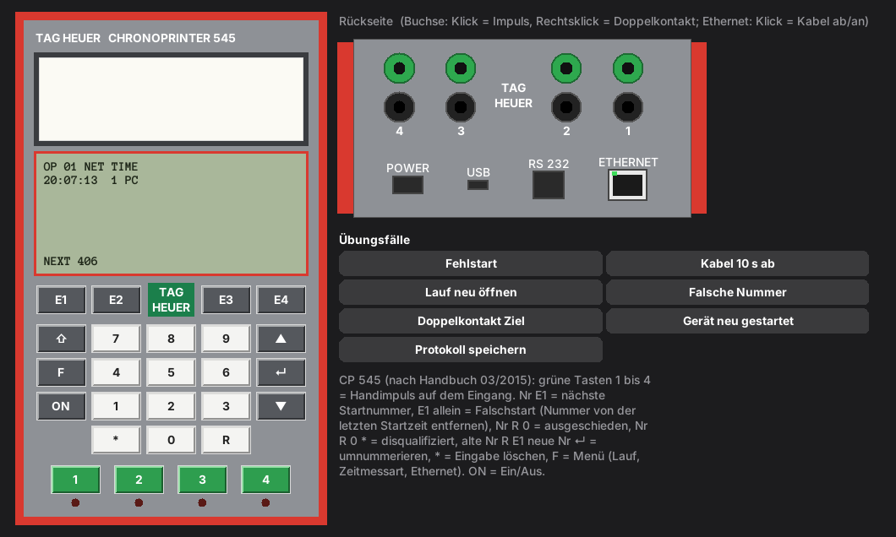
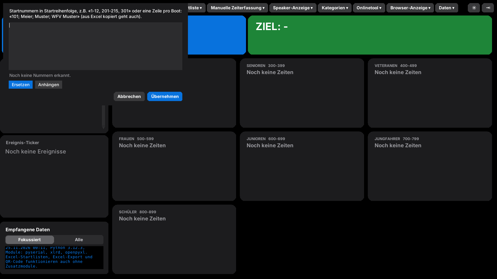
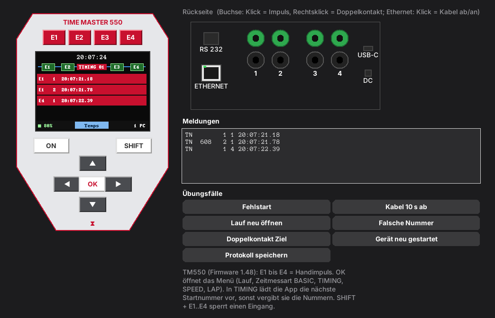
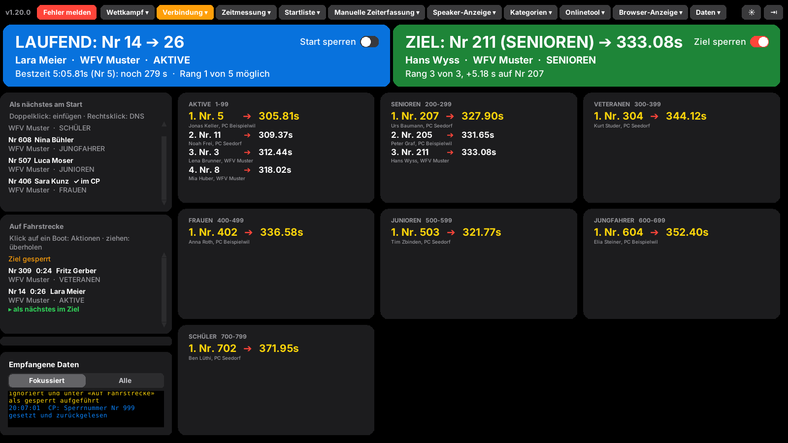

# Training SWV Live-Ranking

Stand: App v1.20.0. Alle Übungen laufen ohne echtes Gerät mit dem eingebauten Simulator. Die App ist mit dem
Simulator verbunden wie mit einem echten CP 545 oder TM550. Nachschlagen im [Benutzerhandbuch](benutzerhandbuch.md).

| Stufe | Ziel | Dauer |
| --- | --- | --- |
| [1 Einsteiger](#stufe-1-einsteiger) | App kennen, Startliste laden, einen Lauf ohne Störung begleiten | 45 min |
| [2 Fortgeschritten](#stufe-2-fortgeschritten) | Korrekturen: Fehlstart, falsche Nummer, Überholen, Fehlimpuls, DNS, DNF, DSQ | 60 min |
| [3 Profi](#stufe-3-profi) | Störungen: Kabel ab, Gerät neu gestartet, Lauf neu geöffnet, Reserve-Gerät, Sperren | 60 min |

## Vorbereitung

1. App starten. Das Menü ist oben, jeder Knopf klappt einen Bereich auf.
2. «Verbindung ▾ › Simulator». Das Fenster bietet «Start», «Ziel», «Nächste Zeile verlieren»,
   «Automatisch (Start alle 15 s)», «Log abspielen …», «Üben: CP 545 mit Tastatur», «Üben: TM550» und
   «Simulator beenden».
3. «Üben: CP 545 mit Tastatur» öffnet das nachgebaute Gerät.

| Teil des Fensters | Bedienung |
| --- | --- |
| Papierstreifen oben | was der CP druckt |
| Display (8 Zeilen à 21 Zeichen) | Lauf, Zeitmessart, letzte Zeiten, nächste Nummer (`NEXT`) |
| Tastenfeld | wie am echten CP (E1 bis E4, Ziffern, R, \*, F, ON, Pfeile, ↵) |
| grüne Tasten 1 bis 4 | Handimpuls auf Eingang 1 bis 4 |
| Rückseite | Klick auf eine Buchse = Impuls, Rechtsklick = Doppelkontakt, Klick auf Ethernet = Kabel ab/an |
| Übungsfälle | Knöpfe für Störungen, siehe unten |
| «Protokoll speichern» | Übungsprotokoll in `Dokumente\SWV Live-Ranking\training` |

Taste **F** öffnet das Menü des Simulators: «Lauf schliessen», «Neuen Lauf öffnen», «Lauf mit gleicher Nummer neu
öffnen», Zeitmessart (NET TIME, PTB SEQUENTIEL 1-4, START - FINISH), «Einstellungen › Ethernet einschalten».

## Stufe 1: Einsteiger

### Übung 1.1 Oberfläche

1. Jeden Knopf der Menüleiste einmal aufklappen und den Inhalt mit dem [Benutzerhandbuch, Abschnitt 3](benutzerhandbuch.md#3-hauptfenster) vergleichen.
2. ⇥ drücken (Seitenleiste angepinnt), nochmals drücken (Menü oben).
3. ☀/☾ wechselt Hell und Dunkel.

Kontrolle: die Farbe des Knopfs «Verbindung» erklären können (grün, orange, rot).

### Übung 1.2 Wettkampf und Startliste

1. «Wettkampf ▾»: Name «Training», Datum von heute.
2. «Startliste ▾ › Startliste eingeben»: `1-5, 201-204, 301-303` eintragen, «Übernehmen».

3. «Kategorien ▾»: drei Kategorien anlegen, z.B. AKTIVE 1 bis 99, SENIOREN 200 bis 299, VETERANEN 300 bis 399.
4. Alternativ eine Excel-Startliste laden und im Importfenster die Spalten prüfen.

Kontrolle: «Als nächstes am Start» zeigt Nr 1 zuoberst, drei leere Ranglisten-Karten.

### Übung 1.3 Erster Lauf am CP 545

1. Simulator CP 545 öffnen. Im Display steht `OP 01 NET TIME`, die App lädt Nr 1 (`NEXT 1`, in der App «im CP»).
2. Grüne Taste **1** (Start). Nr 1 erscheint unter «Auf Fahrstrecke», das blaue Feld zeigt die laufende Zeit.
3. Grüne Taste **1** nochmals (Start Nr 2), dann nochmals (Start Nr 3).
4. Grüne Taste **4** (Ziel). Nr 1 bekommt die Zeit, das grüne Feld ZIEL zeigt Rang und Zeit.
5. Taste 4 zweimal für Nr 2 und Nr 3.

Kontrolle: Papierstreifen, Display und Rangliste zeigen dieselben Zeiten mit derselben Anzahl Stellen.

### Übung 1.4 Erster Lauf am TM550

1. Simulator schliessen, «Üben: TM550» öffnen.
2. **E1** = Start, **E4** = Ziel. Ablauf wie Übung 1.3.

Kontrolle: unter «Meldungen» stehen die TN-Zeilen, in der App dieselben Zeiten.

### Übung 1.5 Abschluss

1. «Daten ▾ › PDF und Drucken ▾ › Rangliste als PDF».
2. «Daten ▾ › Resultate zurücksetzen» für die nächste Übung.

## Stufe 2: Fortgeschritten

Vor jeder Übung: Simulator CP 545 offen, Startliste aus Stufe 1, Resultate zurückgesetzt.

### Übung 2.1 Fehlstart

1. Übungsfall «Fehlstart». Der Start wird ausgelöst, Nr 1 steht auf der Strecke.
2. Am CP **E1** allein drücken. Die Nummer wird von der Startzeit entfernt (`TC`).
3. Grüne Taste 1: Nr 1 startet nochmals.

Am TM550: Startzeit in der App als Fehlimpuls verwerfen.

Kontrolle: Nr 1 hat nur eine Startzeit, die zweite.

### Übung 2.2 Falsche Nummer am Start

1. Übungsfall «Falsche Nummer». Der CP startet eine Nummer, die 7 höher ist als die richtige.
2. Korrigieren am CP: **falsche Nr R E1 richtige Nr ↵**. Der CP meldet `T-` (alte) und `T*` (neue).
3. Alternativ in der App: Klick auf das Boot unter «Auf Fahrstrecke» › «Nummer ändern …».

Kontrolle: unter «Auf Fahrstrecke» steht die richtige Nummer mit der ursprünglichen Startzeit.

### Übung 2.3 Überholen

1. Nr 1 und Nr 2 starten.
2. Klick auf Nr 2 unter «Auf Fahrstrecke» › «Kommt als nächstes ins Ziel (überholt)», oder Nr 2 über Nr 1 ziehen.
3. Taste 4: Nr 2 bekommt die Zeit.
4. Zielzeit schon beim falschen Boot: Klick auf das richtige Boot › «Letzte Zielzeit gehört Nr …».

### Übung 2.4 Fehlimpuls und Doppelkontakt am Ziel

1. Ein Boot starten, auf der Rückseite mit Rechtsklick auf die Zielbuchse einen Doppelkontakt auslösen
   (oder Übungsfall «Doppelkontakt Ziel»).
2. Die Prellzeit Ziel fängt den zweiten Impuls ab. Im Log steht der ignorierte Impuls.
3. Einen zweiten Zielimpuls ohne Boot im Ziel auslösen. Klick auf die Zeile letzter Zieleinlauf unter
   «Auf Fahrstrecke» › «Zielzeit ungültig (Fehlimpuls), Boot wieder auf die Strecke».

Kontrolle: das Boot ist wieder auf der Strecke, die nächste Zielzeit gehört ihm.

### Übung 2.5 DNS, DNF, DSQ

| Fall | In der App | Am CP |
| --- | --- | --- |
| Boot nicht am Start (DNS) | Rechtsklick in «Als nächstes am Start» › «Nicht gestartet (DNS)» | |
| Boot wieder da | Rechtsklick › «Abwesende (DNS) darunter wieder einfügen» | |
| Boot fehlt in der Liste | Rechtsklick › «Nummer darunter einfügen …» | |
| ausgeschieden (DNF) | Klick auf das Boot unter «Auf Fahrstrecke» › «Ausgeschieden (DNF)» | Nr R 0 |
| disqualifiziert, fährt weiter | Klick › «Disqualifiziert, fährt weiter ins Ziel (DSQ)» | Nr R 0 \* |
| disqualifiziert, schon draussen | Klick › «Disqualifiziert, ist schon draussen (DSQ)» | |
| DSQ nach dem Ziel | Rechtsklick in der Rangliste › «Disqualifiziert (DSQ)» | |
| DSQ zurücknehmen | Klick › «DSQ aufheben» | |

### Übung 2.6 Manuelle Zeit

1. «Manuelle Zeiterfassung ▾», Startnummer eintragen, «Zeit manuell erfassen».
2. Minuten, Sekunden, Zehntel eingeben.

Kontrolle: das Boot steht in der Rangliste.

## Stufe 3: Profi

### Übung 3.1 Kabel ab

1. Zwei Boote starten.
2. Übungsfall «Kabel 10 s ab». In dieser Zeit ein Ziel auslösen.
3. Nach 10 s ist das Kabel wieder dran. Die App holt die fehlende Zeit selbst (`#RT`).

Kontrolle: die Zielzeit während des Unterbruchs ist in der Rangliste. Falls nicht: «Verbindung ▾ › Lauf vom CP laden».

### Übung 3.2 Gerät neu gestartet

1. Übungsfall «Gerät neu gestartet».
2. CP 545: Ethernet ist aus. **F › Einstellungen › Ethernet einschalten**. Die App verbindet wieder.
3. TM550: verbindet wieder, Uhrzeit am Gerät prüfen.
4. Fehlende Zeiten: «Lauf vom CP laden».

### Übung 3.3 Lauf neu geöffnet

1. Übungsfall «Lauf neu öffnen» (Lauf geschlossen und mit gleicher Nummer wieder geöffnet).
2. Prüfen: Boote auf der Strecke bleiben, die nächste Startnummer wird wieder geladen.
3. Mit **F › Lauf schliessen** und **F › Neuen Lauf öffnen** einen neuen Lauf anfangen.

### Übung 3.4 Zeitmessart falsch

1. **F › Zeitmessart PTB SEQUENTIEL 1-4**.
2. Die App meldet, dass der CP keine Startnummern annimmt, und nummeriert selbst aus der Startreihenfolge.
3. Zurück auf **NET TIME**, Lauf öffnen.

### Übung 3.5 Start und Ziel sperren

1. Boot starten, «Ziel sperren» im grünen Feld einschalten. Bei Booten auf der Strecke fragt die App nach.
2. Zielimpuls auslösen: er erscheint unter «Auf Fahrstrecke» als gesperrt.
3. Klick auf die Zeile › «Nr … zuordnen» oder «Ungültig lassen (ausblenden)».
4. Ziel freigeben.

Bei gesperrtem Start lädt die App die Sperrnummer (Standard 999) in den CP.

### Übung 3.6 Präzision

1. «Zeitmessung ▾ › Präzision (abschneiden)» auf 1/10 stellen, «Präzision am Gerät einstellen».
2. Boot starten und ins Ziel bringen.

Kontrolle: Papier, Display und App zeigen eine Stelle nach dem Komma. Zeiten werden abgeschnitten, nicht gerundet.

### Übung 3.7 Reserve-Gerät (mit echter Hardware)

Nur mit zwei Geräten an denselben Impulsen, z.B. CP 545 über USB und TM550 über Ethernet.

1. Hauptgerät verbinden, «Reserve-Gerät» wählen, «Reserve verbinden». «Verbindung» wird grün.
2. Impuls nur am Reserve-Gerät auslösen (Handtaste). Die App fragt: «Reserve übernehmen» oder
   «Hauptgerät gilt (Impuls verwerfen)», optional «Für diese Sitzung immer so».
3. Hauptgerät trennen: die Reserve liefert alle Zeiten, «Verbindung» wird orange.

### Übung 3.8 Fehlerbericht

1. **F12** drücken, kurz beschreiben, «Bericht speichern».
2. ZIP-Datei in `Dokumente\SWV Live-Ranking\fehlerberichte` finden.

### Übung 3.9 Generalprobe

1. Startliste laden, «Automatisch (Start alle 15 s)» im Simulator einschalten.
2. Ziele von Hand auslösen, dabei je einmal: Fehlstart, falsche Nummer, Überholen, Fehlimpuls, DNF, Kabel ab.
3. Am Ende Rangliste als PDF, Export pro Verein, «Protokoll speichern».

Kontrolle: alle Boote haben eine Zeit oder einen Status (DNS, DNF, DSQ), keine Zeile bleibt ungeklärt
unter «Auf Fahrstrecke».
